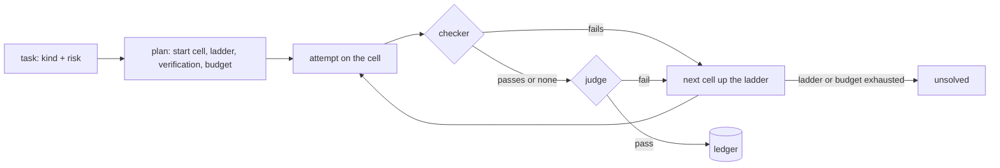

# model-router

A model router for Claude. Give it a task and it picks a model and an effort level, runs the
task, checks the answer as hard as the risk asks, moves to a stronger model when the answer fails,
and writes down what every solved task cost. It works from the command line, as a Python library
and inside Claude Code, where it is mostly about subagents: a hook gives each one the model, the
effort and the agent it needs, sends reading work to a read-only agent that carries a fraction of
the context, and measures what every subagent really spent. Claude models only.

Status: experimental. The capability of each cell is a stated assumption, not a measurement; the
ledger and `router calibrate` exist to replace those assumptions with real verdicts (see
"Assumptions").

## How it works

Four steps, for every task:

1. **Classify.** A kind (extract, code, write, review, analysis...) and a risk (low to critical).
   You declare them, or rules guess them from the text.
2. **Start cheap.** A table by kind and risk names the first cell, a model at an effort:
   `haiku/medium` for a low-risk extraction, `opus/medium` for a high-risk review. Risk floors
   keep critical work off the cheap cells.
3. **Verify by risk.** A programmatic checker first, when the task has one: free, and final when
   it fails. From high risk up, a judge on another model reads the answer in a fresh context. Low
   and medium risk go unverified.
4. **Escalate on a fail.** The next cell up the ladder gets the task again, with the reason it
   failed. Every attempt, verdict and cost goes to the ledger, and `router calibrate` turns those
   verdicts into a better start table.




That is the whole router. Two judges at once, blind to each other, with an arbiter when they
disagree, is a separate plugin in the same repository: the [tribunal](plugins/tribunal/README.md).
It reviews the code each turn changes, and critical texts when you ask. You install it apart, and
the router works the same without it.

## Where the idea comes from

A reel by @donimas ("router picks model + effort · verify by risk"). Four things are different
here, and each one has its reason in the table.

| Reel | Here | Why |
|---|---|---|
| A ladder of models: Sonnet ×1, then Opus ×2, then Fable ×5 | A lattice of (model, effort) cells sorted by cost, with an estimated capability per cell | Anthropic's cost guidance says Fable at `low` often costs less per solved task than Opus at `high`. A ladder of models never tries that cell; the lattice does. |
| Verify "by risk" | An order of trust: a programmatic checker first (free, and final when it fails), then one judge on another model than the worker, with a scoreboard of who was right | A code checker beats any judge, and a judge on another model is a blind cross-check. Two judges and an arbiter are a separate plugin, the tribunal. |
| "Feedback" | First-attempt pass rate per (kind, cell), kept apart from escalated attempts; it moves the start cell once there are 10 verdicts or more; a human can override it with `router feedback` | Escalated attempts only see the tasks the cheap cell already failed. Mixing them inflates the failure rate of the expensive cell. |
| "Simulated workload · real prices" | The same, but the simulation states its assumptions, includes the hard tail and the judge's false passes, and adds the honest cell the reel leaves out: Fable at low | A router that is never compared with "the best cheap model" proves nothing. |

What it does not do: it decides nothing from real data until you have real verdicts.

Compared with learned routers: [RouteLLM](https://lmsys.org/blog/2024-07-01-routellm/) trains a router on
preference data to send each query to a strong or a weak model, [LLMRouter](https://huggingface.co/papers/2608.06867)
collects more than a dozen routers of that kind, and [RouterArena](https://openreview.net/pdf/03e5d4326116c387dbd69c38e194211db0736cda.pdf)
ranks them. This is not one of those. Nothing is trained: the start cell comes from a table by kind and risk,
and a cell is model and effort inside one provider. The difference is what happens after the answer: a checker
or a judge verifies it, a failure climbs the ladder, and every verdict feeds the table. If you want a learned
router across providers, take one of those; this one picks the effort inside Claude Code and verifies by risk.

## Install

Requirements: Python 3.12 or later, [uv](https://docs.astral.sh/uv/), and Claude Code if you want
the hook or the backend that needs no API key.

### As a Claude Code plugin (hooks, skill, read-only agent)

Inside Claude Code, one line (2.1.275 or later):

```
/plugin install model-router --marketplace dcamunas/model-router
```

Or from a terminal:

```bash
claude plugin marketplace add dcamunas/model-router
claude plugin install model-router@dcamunas
```

The repository is both the marketplace (`dcamunas`) and the plugin (`model-router`); the marketplace
also carries [`tribunal`](plugins/tribunal/README.md), the code-review plugin, which you install the same way when you want it. The first
session takes a few seconds longer: the hook builds its own Python environment with `uv` in the
plugin's data directory (`plugins/data/model-router-dcamunas/` inside the profile) and reuses it
afterwards; with every new plugin version it rebuilds it on its own. `uv` has to be on the machine
(`MODEL_ROUTER_UV=/path/to/uv` when it is not on the PATH). The only change to `settings.json` is
the plugin being enabled.

If your plan or your account lacks a model (no Fable, say), or you want `router run`, install the
CLI too and tell it once:

```bash
uv tool install git+https://github.com/dcamunas/model-router@v0.15.1
router config --models haiku,sonnet,opus    # touches neither hooks nor skill
router doctor                               # claude, profile, plugin or hooks, available models, state
```

### With the CLI, where plugins are not an option

Profiles where a policy blocks marketplaces, or one specific repository: `router install` writes
the same hooks into the profile's `settings.json` and copies the skill and the read-only agent
(as `router-reader`) into the profile.

```bash
uv tool install git+https://github.com/dcamunas/model-router@v0.15.1
router install                              # hooks + skill in the active profile ($CLAUDE_CONFIG_DIR or ~/.claude)
router install --models haiku,sonnet,opus   # without Fable
router doctor
```

The tables do not change: when they ask for a model you do not have, the router drops to the most
capable available model at the same effort and the ladder goes on from there (`router plan` says so
in its explanation). The variable `MODEL_ROUTER_MODELS=haiku,sonnet,opus` does the same without
touching the configuration.

Another profile, one repository, or removing it:

```bash
router install --settings ~/.claude-other/settings.json --profile-dir ~/.claude-other
router install --settings .claude/settings.json --no-skill
router uninstall
```

Upgrade: `uv tool upgrade model-router` (or install another tag) and `router install` again. What
changes in each version is in `CHANGELOG.md`.

To work on the repository:

```bash
git clone https://github.com/dcamunas/model-router && cd model-router
uv sync
uv run router install --link    # the skill is linked to the repository instead of copied
uv run pytest -q
claude --plugin-dir .           # or try the plugin as it is in the repository, for that session only
```

Real calls from the command line need a credential: `ANTHROPIC_API_KEY` in the environment or,
without it, your Claude Code account (see "Without an API key"). `plan`, `bench --simulate`,
`cells`, `stats` and `doctor` (without `--live`) do not call the API.

## Usage

```bash
# What the router would do with a task, at no cost
router plan "Review this SQL migration script before it goes to production"
#   classification: review / high  (rule 'review'; risk: high-risk keyword)
#   start: opus/medium  -> Claude Code {'model': 'opus', 'effort': 'medium'}
#     - table review x high -> opus/medium
#     - ladder: opus/medium -> fable/low -> fable/xhigh
#     - verification light (risk high); budget $2.00; max 4 attempts
#   verifier (light): fable/low

# Only model/effort, for the frontmatter of a Claude Code agent
router plan "classify these tickets" --claude-code
#   model: haiku
#   effort: low

# Run it for real, with a programmatic checker
router run "Return a JSON object with the keys name, tax_id and date from: ..." \
    --kind extract --risk high --check-json name,tax_id,date

# Judge an answer written elsewhere (a subagent, a person) with the task's judges; exit 1 on a fail
router judge "Write the incident notice for ..." --kind write --risk critical --answer notice.md

# Compare strategies (offline, no API)
router bench --simulate --tasks 200 --seed 1

# Compare strategies on real tasks (spends money or quota; asks first)
router bench tasks.yaml --strategies "router,fable/low,opus/high,sonnet/medium>opus/high"

# The same three times per task, fixed cells verified as the router would, and a dry run first
router bench tasks.yaml --strategies "router,fable/low" --repeat 3 --verify auto --dry-run

# Every cell on its own (or --cells), verified as the router would: what `router calibrate` measures from
router bench tasks.yaml --matrix --cells haiku/low,sonnet/low,opus/low --repeat 3 --max-usd 20

# Measure the start table from the benches and the ledger; --apply makes it the one that decides
router calibrate
router calibrate --apply
router bench tasks.yaml --strategies "router@builtin,router"   # before and after, on the same eval

# How often the rule classifier gets kind and risk right on your eval (and Haiku, with --llm)
router calibrate --classifier tasks.yaml

# What has happened so far and what it has learned
router stats

# The SQLite index of the ledger: its state, or rebuild it from the JSON-lines files
router db
router db rebuild

# Correct a verdict by hand (it feeds the feedback store)
router feedback <task_id> --ko --note "the judge accepted a badly parsed date"
```

Format of `tasks.yaml` for the real bench (full example in `tasks.example.yaml`):

```yaml
tasks:
  - id: tax-id-01
    prompt: "Extract name and tax id from the following text as JSON: ..."
    kind: extract          # optional, inferred by rules
    risk: high             # optional
    check_json: [name, tax_id]
  - id: sql-01
    prompt: "Write the BigQuery query that ..."
    check_regex: "SELECT[\\s\\S]*FROM"
```

## Without an API key: with your Claude account

`router run` and `router bench` do not need `ANTHROPIC_API_KEY`. Without it they use the `cli`
backend: every call is one `claude -p` process (Claude Code's headless mode) with the cell's model
and effort, no tools, no MCP and a minimal system prompt, about 900 tokens per call (without
`--system-prompt`, Claude Code would send its full prompt, about 100K). Structured outputs go
through `--json-schema`. It spends your subscription's quota, not dollars: the amounts in the ledger
are the list-price equivalent, a proxy for quota use.

The Claude profile it uses, in order: `MODEL_ROUTER_CLAUDE_CONFIG_DIR`, `claude_config_dir` in
`~/.model-router/config.json` (written by `router install` or `router config`), `CLAUDE_CONFIG_DIR`.
With none of them it refuses to start, so it never uses another profile by accident. `router doctor`
says which one it is using.

Differences from the `api` backend: no `max_tokens` and no server-side refusal fallbacks, and every
call takes one or two seconds more because of the process start-up. `--backend api|cli` forces one
or the other.

## Inside Claude Code

A subagent's bill is mostly its context, read again on every turn: the tools, the MCP servers, the
skills and the conversation so far. A review subagent on Opus measured in this repository took 36
turns and read 3.6M cached tokens: 1.43 USD at list price for its context alone. So the plugin
works on three things, all of them on Claude models:

- **Model and effort.** `PreToolUse` on the Agent tool sets `model` and `effort` for every
  general-purpose subagent launched without a model, from the kind and the risk declared on the first
  line of the prompt (`kind: review, risk: high`), else inferred from the text, and from the active
  calibration. A critical review never runs on the model serving the chat.
- **The agent.** Reading work goes to `model-router:reader`, a read-only agent with Read, Grep, Glob,
  WebFetch and WebSearch: no edits, no shell, no MCP servers. The same review of one file, on the same
  model and effort, cost 0.0029 USD of context on the general agent and 0.0009 USD on the read-only
  one, 70 % less, with a quarter of the context written to the cache. `access: read` on the first line
  of the prompt, on a line of declarations only (`kind: review, risk: low, access: read`), sends a
  subagent there; anything else keeps the general agent. The hook does not guess from the wording: a
  test of 71 realistic write requests found half of them phrased like reading work ("find where the
  timeout is set and set it to 30"). Whoever launches the subagent knows whether it writes, and the
  session context asks Claude to say so. When the reader is handed work it cannot do, it says so and
  asks to be relaunched with `access: write`.
- **Measurement.** `SubagentStop` reads each finished subagent's transcript and records its model,
  turns, tokens (cache reads and writes included), peak context, tool calls and duration, next to the
  routing decision. `router stats` shows it per agent and model. Context tokens are exact; output
  tokens are a lower bound (a transcript keeps the usage taken when each message began), so the cost
  shown is a floor, and almost all of it is context anyway.

- **Learning per project.** Each measurement carries its project (the git repository) and a
  signature of its prompt: sixteen salted numbers, no text. When Claude relaunches the same task (same
  kind and risk, an alike prompt, same session, within 30 minutes) on a bigger model or with more
  effort, the first launch counts as a fail. Moving from the read-only agent to the general one does
  not: the model was not the problem. Only launches where the router chose both model and effort
  count, from the last 13 whole weeks. If the cell a kind and risk starts on fails in 2 of 6 launches
  or more (30 % at least), it starts one step up in that project from the next session, and Claude
  Code says so. Going back down is only proposed, after 10 launches without a fail, to the cell it was
  raised from or to one at least 20 % cheaper, and you apply it. The risk floors always hold. The
  tuning lives in `~/.model-router/projects/`; `--reset` or `--apply` restart the count, so what was
  already weighed does not move it again.

- **Shared through the repository (optional).** One person's numbers grow slowly. A team can pool them:
  `router project --share` creates `.claude/model-router/` in the repo. Once that directory is
  committed, every teammate's router adds one small file there per closed week, never changed
  afterwards:

  ```json
  {"v":1,"c":{"review|high|opus/medium":[12,1]}}
  ```

  That is launches and fails per kind, risk and start cell. The file holds no prompts, signatures,
  paths, names, costs or times. Its name is a salted hash plus the week. Files never change, so
  branches and merges do not fight over them, and any router deletes a file a week after it leaves the
  13-week window. Each router counts the others' files with its own log, but never its own files,
  which would count it twice. The same rules apply: weeks before a reset do not count, and one
  installation weighs at most 30 launches per cell, at its own fail rate. Links in that directory are
  never followed. The team's counts alone never raise a start. A raise happens on its own only with at
  least one fail on your machine too; otherwise `router project` proposes it. `MODEL_ROUTER_SHARE=0`
  keeps one installation out. Git still records who committed each file, so anyone who looks can see
  weekly counts per person.

```bash
router stats                 # ... then "Claude Code subagents, measured from their transcripts"
router project               # this repo: routed subagents, relaunches, tuning in force, cheaper starts proposed
router project --apply       # apply the proposed changes; --reset removes the project's tuning
router project --share       # pool counts with the team through .claude/model-router/ in the repo
router config --lean off     # keep every subagent on the agent Claude chose
```

Alone, the numbers grow slowly: six launches of one kind on one start cell in one project before
anything moves. That is on purpose; a tuning built on two runs would be noise. Shared, they grow with
the team.

`SessionStart` tells Claude the hook exists and what to declare. The skill `router` covers what a
hook cannot do: verify a subagent's result, escalate, and send text-only subtasks through `router
run`, which carries no session context at all. The hooks call no API, take a few tenths of a second
and never block: on any error they exit quietly. Agents defined in `.claude/agents/*.md` and forks are
left alone; they are still measured.

Environment variables: `MODEL_ROUTER_HOOK=0` turns the hooks off without uninstalling;
`MODEL_ROUTER_LEAN=0` keeps subagents off the read-only agent; `MODEL_ROUTER_SHARE=0` keeps this
installation out of a repository's shared counts; `MODEL_ROUTER_HOOK_QUIET=1` removes
the one-line notice; `MODEL_ROUTER_HOOK_LOG=0` stops logging decisions and measurements;
`MODEL_ROUTER_UV` tells the plugin where `uv` is. Decisions go to `~/.model-router/hook.jsonl` and
measurements to `~/.model-router/subagents.jsonl`.

## As a library

```python
from model_router import Router, Task, json_checker
from model_router.client import LiveClient

router = Router(LiveClient())
result = router.run(Task(
    prompt="Extract name, tax id and date from the text as JSON: ...",
    kind="extract", risk="high", checker=json_checker(("name", "tax_id", "date")),
))
print(result.status, result.final_cell, f"${result.total_cost_usd:.4f}")
print(result.answer)
```

`Task` takes `output_schema` (a pydantic model for structured output), `system`, `budget_usd`,
`max_attempts` and `verify` to force the mode. `Router` accepts any object with
`complete(cell, prompt=..., ...)`, so it can be tested without a network
(`model_router.testing.FakeClient`).

## How it decides, in detail

1. Kind and risk. You pass them (`--kind`, `--risk`), or the first two lines of the text declare them
   (`kind: review, risk: high`; also `tipo:` and `riesgo: alto`; a value ends the line or is followed
   by a comma or a full stop, and material pasted below the head never counts), or rules infer them (the
   rules know English and Spanish prompts); `--classify-llm` uses Haiku. The risk is the damage a
   wrong answer does, and the text does not carry it: on 28 real tasks the rules got it right 9
   times and Haiku 5 to 10, both reading difficulty or vocabulary instead of consequences. So
   `critical` is never inferred, only declared or passed, and a text that says "critical" or
   "production" is not a critical task for it; the high-risk keywords (money, customers,
   production, deletions, legal, health, credentials) still raise an undeclared risk to `high`.
2. Start cell. The `START` table in `policy.py` (kind × risk), or the table of the active calibration
   (`router calibrate --apply`; `router plan` names it, see "Assumptions"). With 10 or more verified verdicts (a checker
   or a judge) for that kind, the feedback store moves it up when its first-attempt pass rate falls below the break-even
   `c1 / c2` (the cost of an attempt on that cell, verification included, over the cost of the next
   step): below that, starting cheap costs more. The risk floors (`high` ≥ sonnet/low, `critical`
   ≥ opus/medium) cannot be lowered.
3. Ladder. Each step is the cheapest cell that is clearly more capable (+0.08 capability) among the
   available models. With the current assumptions: `sonnet/medium -> opus/low -> fable/low -> fable/xhigh`.
4. Verification. `low` and `medium` none, `high` light, `critical` full (full verification was the
   biggest cost sink; raise `high` to `full` with `--verify full`, or in `policy.py` once your bench
   justifies it). When the task has a checker, the checker goes first and is final when it fails.
   `light` is the nearest other model at low effort (the tier above first), in a fresh context: a worker
   judging itself passed a quarter of the answers an independent judge failed. `full` is one fixed judge, `opus/xhigh` unless
   `router config --judge` or `MODEL_ROUTER_JUDGE` say otherwise, on another model than the worker
   (see "Who judges"). Two judges at once are the tribunal plugin's job: the router's plan never asks
   for them, and a task file that says `verify: tribunal` is refused.
5. Stopping. A passing verdict, the ladder exhausted, the budget by risk (0.10 / 0.50 / 2 / 10 USD),
   two refusals in the same task, the API down, or a judge that cannot be reached (the answer is
   kept and the status is `error`). An answer cut by `max_tokens` is retried once on
   the same cell with twice the room.
6. Ledger. `~/.model-router/ledger.jsonl` (`MODEL_ROUTER_HOME` moves it): every attempt with its
   real tokens, cost, the model that served it (when a fallback ran), verdict and reason, plus the
   router version and the calibration that decided, the task's fingerprint (a hash of kind, risk and
   prompt, so the same task can be compared across strategies and versions) and, for bench runs, the
   eval file and the repetition. `router.db` next to it is a SQLite index of the same records (tasks,
   attempts, every judge's verdict, overrides) for queries across months; the JSON-lines file stays
   the source, and `router db rebuild` reloads the index from it.
7. Escalation. After a verified fail, the next attempt's prompt carries the reason, so the next cell
   does not repeat the mistake; `router stats` counts the retries that repeat it anyway.

## Who judges

Who judges is a fixed choice, not a climb up the lattice. `full` uses one judge cell, `opus/xhigh`
unless `router config --judge` or `MODEL_ROUTER_JUDGE` say otherwise, in a fresh context. When the
worker is already on that model the judge moves to the next model up at low effort (Fable at low
for an Opus worker), or to the model below when there is nothing above, so the check stays a
cross-check between models. No judge thinks above `xhigh`, and `router config --judge opus/high`
is the cheaper setting when verification is most of the bill: a judge at `high` writes about 60 %
less thinking than one at `xhigh`. Verifying is easier than producing, so the judge does not have
to outrank the worker; it has to be independent and good enough.

`light` is the nearest other model at low effort, the tier above before the one below. Until 0.11.0
it was the worker's own cell in a fresh context. On a private eval of 28 real tasks, Haiku and Sonnet
passed themselves on 89 % and 93 % of first attempts; an Opus judge passed 64 % and 68 % of the same
answers, for word limits broken, formats ignored and facts invented. A model does not see its own
blind spots in a fresh context either.

Every judge's own verdict goes to the ledger, so `router stats` keeps a scoreboard per judge cell:
verdicts, pass rate, and how many of its verdicts you contradicted with `router feedback`. Those are
the numbers to pick a judge with, instead of the error rates the simulation assumes.

## What leaves your machine

- The hooks call no API: they classify by rules, locally. Every decision goes to
  `~/.model-router/hook.jsonl` with the first 60 characters of the subagent's prompt and a hash of
  it; every measurement goes to `~/.model-router/subagents.jsonl` with numbers, that hash, a
  signature of sixteen numbers (no text) and the project's path, read from the transcript Claude Code
  already keeps on your disk. A project's tuning goes to `~/.model-router/projects/`.
- In a repository that shares counts, the hook adds weekly files to `.claude/model-router/` with the
  counts above and nothing else. They leave your machine only when you commit and push them.
- `router run`, `router judge` and `router bench` send the prompt to Anthropic, through your API key
  or your Claude Code account, and to nobody else. (The tribunal plugin also sends a reviewed change
  to Codex; its README says what goes.)
- The ledger and its SQLite index keep tokens, cost, cell, verdict and the judges' reasons for every
  attempt; they keep neither the prompt nor the answer, only a hash of the task. A reason may quote a
  few words of either.
- `router plan`, `router stats`, `router cells` and `router doctor` without `--live` call nothing.

## Assumptions (read them before you believe a number)

- The start table is an assumption until you calibrate it. `router calibrate` measures, from your
  benches and your ledger, the first-attempt pass rate per kind and cell with its 95 % interval, the
  mean cost of an attempt and the expected cost per solved task, and proposes a table; a change
  needs evidence (a cheaper cell that was measured and passes, or the current cell measured and
  beaten), six first attempts at least, and the risk floors hold. Only independent verdicts count: a
  checker, or a judge on a model other than the worker's that backed the final verdict; a verdict the worker's own model alone gave is reported and left out, because a
  cheap cell passes itself. `--apply` makes it the table that
  decides: `router plan` names it, `router doctor` names it, and every record carries its id. A
  calibration moves where a task starts, not the ladder: escalation still climbs by the capability
  below. No calibration ships with the package; the only measured numbers are yours.
- Prices in `catalog.py`, Anthropic API as of 2026-10-06. The ledger uses the real `usage`.
- `EFFORT_OUTPUT_MULT`: output tokens per effort relative to `high` (0.5 / 0.75 / 1 / 1.6 / 2.5).
- `CAPABILITY_TIER` + `CAPABILITY_EFFORT`: capability 0-1 per cell. Haiku 0.40, Sonnet 0.60,
  Opus 0.75, Fable 0.90; effort adds between −0.06 and +0.05. It is an opinion, not a measurement;
  `router calibrate` prints the measured rates next to it.
- The simulation adds: difficulty per kind, a 15 % hard tail, a `light` judge with 10 % false
  passes and a `full` one with 3 %, and judges that share their draw half the time.
- Prompt caches are per model: every model change in the ladder loses the cache. For a long
  conversation, change cells between conversations, not inside one.

## What is missing before this is a real router

An evaluation set of your own: 20 to 30 real tasks, frozen, with a checker or a reference answer,
run through `router bench tasks.yaml --matrix --repeat 3` and then `router calibrate`. Until then, the only reliable number
this gives you is the real cost per solved task in the ledger. `evals/v1.yaml` is a starter set of
fifteen made-up tasks (ten with a checker, two critical ones without, so a judge decides): copy it and
replace the tasks with yours.

## Development

```bash
uv run pytest -q
uv run ruff check src tests   # style, types on signatures, docstrings on the public API, complexity
uv run pyright                # types
uv run --with pillow docs/showcase/build.py   # the README's GIFs: the trial, and the terminal from docs/showcase/router-run.txt (a real run)
```

GitHub Actions runs the same on every push, checks that the skill ships inside the wheel and
validates the plugin with the Claude Code CLI. Everything in the repository is in English: code,
documentation and what the command line prints.

## Licence

MIT. See `LICENSE`.
