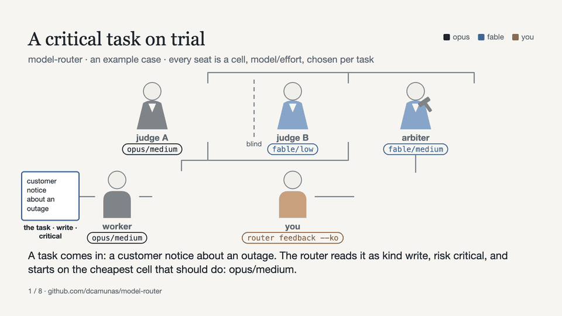
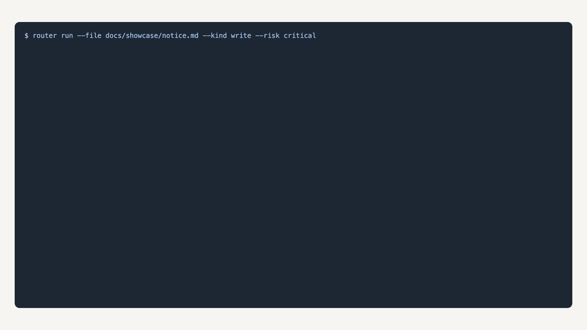
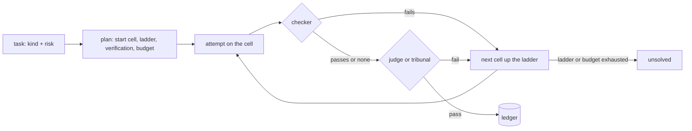
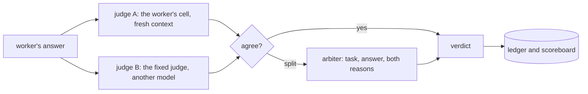

# model-router

A model router for Claude: given a task, it picks a model and an effort level, runs the task,
verifies the answer according to the risk, escalates when the answer fails, and writes down what
every solved task cost. You can use it from the command line, as a Python library and inside Claude
Code, where a hook picks model and effort for every subagent launched without one.



Status: experimental. The capability of each cell is a stated assumption, not a measurement; the
ledger and the feedback store exist to replace those assumptions with real verdicts (see
"Assumptions").

The idea comes from a reel by @donimas ("router picks model + effort · verify by risk"). Four
things are different here, and each one has its reason in the table.

## How it differs from the reel

| Reel | Here | Why |
|---|---|---|
| A ladder of models: Sonnet ×1, then Opus ×2, then Fable ×5 | A lattice of (model, effort) cells sorted by cost, with an estimated capability per cell | Anthropic's cost guidance says Fable at `low` often costs less per solved task than Opus at `high`. A ladder of models never tries that cell; the lattice does. |
| Verify "by risk" | Verify by risk with an order of trust: a programmatic checker first (free, and final when it fails), then a `light` judge (the worker's own cell, fresh context), then a `full` judge (one fixed cell, `opus/xhigh` by default, on another model than the worker); at critical risk, when no checker can decide, a `tribunal`: both judges blind to each other and an arbiter if they split, with a scoreboard of who was right | A code checker beats any judge. The `full` judge is a blind cross-check between models, and the tribunal is what is left of an LLM council once you drop the parts that do not pay. |
| "Feedback" | First-attempt pass rate per (kind, cell), kept apart from escalated attempts; it moves the start cell once there are 10 verdicts or more; a human can override it with `router feedback` | Escalated attempts only see the tasks the cheap cell already failed. Mixing them inflates the failure rate of the expensive cell. |
| "Simulated workload · real prices" | The same, but the simulation states its assumptions, includes the hard tail and the judge's false passes, and adds the honest cell the reel leaves out: Fable at low | A router that is never compared with "the best cheap model" proves nothing. |

What it does not do: it decides nothing from real data until you have real verdicts.

Compared with learned routers: [RouteLLM](https://lmsys.org/blog/2024-07-01-routellm/) trains a router on
preference data to send each query to a strong or a weak model, [LLMRouter](https://huggingface.co/papers/2608.06867)
collects more than a dozen routers of that kind, and [RouterArena](https://openreview.net/pdf/03e5d4326116c387dbd69c38e194211db0736cda.pdf)
ranks them. This is not one of those. Nothing is trained: the start cell comes from a table by kind and risk,
and a cell is model and effort inside one provider. The difference is what happens after the answer: a checker
or a judge verifies it, a failure climbs the ladder, and every verdict feeds the table. If you want a learned
router across providers, take one of those; this one picks the effort inside Claude Code and verifies by risk.





## Install

Requirements: Python 3.12 or later, [uv](https://docs.astral.sh/uv/), and Claude Code if you want
the hook or the backend that needs no API key.

### As a Claude Code plugin (hook + skill)

Inside Claude Code, one line (2.1.275 or later):

```
/plugin install model-router --marketplace dcamunas/model-router
```

Or from a terminal:

```bash
claude plugin marketplace add dcamunas/model-router
claude plugin install model-router@dcamunas
```

The repository is both the marketplace (`dcamunas`) and the plugin (`model-router`). The first
session takes a few seconds longer: the hook builds its own Python environment with `uv` in the
plugin's data directory (`plugins/data/model-router-dcamunas/` inside the profile) and reuses it
afterwards; with every new plugin version it rebuilds it on its own. `uv` has to be on the machine
(`MODEL_ROUTER_UV=/path/to/uv` when it is not on the PATH). The only change to `settings.json` is
the plugin being enabled.

If your plan or your account lacks a model (no Fable, say), or you want `router run`, install the
CLI too and tell it once:

```bash
uv tool install git+https://github.com/dcamunas/model-router@v0.7.0
router config --models haiku,sonnet,opus    # touches neither hooks nor skill
router doctor                               # claude, profile, plugin or hooks, available models, state
```

### With the CLI, where plugins are not an option

Profiles where a policy blocks marketplaces, or one specific repository: `router install` writes
the same hooks and the same skill into the profile's `settings.json`.

```bash
uv tool install git+https://github.com/dcamunas/model-router@v0.7.0
router install                              # hooks + skill in the active profile ($CLAUDE_CONFIG_DIR or ~/.claude)
router install --models haiku,sonnet,opus   # without Fable
router doctor
```

The tables do not change: when they ask for a model you do not have, the router drops to the most
capable available model at the same effort and the ladder goes on from there (`router plan` says so
in its explanation). The variable `MODEL_ROUTER_MODELS=haiku,sonnet,opus` does the same without
touching the configuration.

Another profile, one repository, or removing it:

```bash
router install --settings ~/.claude-other/settings.json --profile-dir ~/.claude-other
router install --settings .claude/settings.json --no-skill
router uninstall
```

Upgrade: `uv tool upgrade model-router` (or install another tag) and `router install` again. What
changes in each version is in `CHANGELOG.md`.

To work on the repository:

```bash
git clone https://github.com/dcamunas/model-router && cd model-router
uv sync
uv run router install --link    # the skill is linked to the repository instead of copied
uv run pytest -q
claude --plugin-dir .           # or try the plugin as it is in the repository, for that session only
```

Real calls from the command line need a credential: `ANTHROPIC_API_KEY` in the environment or,
without it, your Claude Code account (see "Without an API key"). `plan`, `bench --simulate`,
`cells`, `stats` and `doctor` (without `--live`) do not call the API.

## Usage

```bash
# What the router would do with a task, at no cost
router plan "Review this SQL migration script before it goes to production"
#   classification: review / high  (rule 'review'; risk: high-risk keyword)
#   start: opus/medium  -> Claude Code {'model': 'opus', 'effort': 'medium'}
#     - table review x high -> opus/medium
#     - ladder: opus/medium -> fable/low -> fable/xhigh
#     - verification light (risk high); budget $2.00; max 4 attempts
#   verifier (light): opus/medium

# Only model/effort, for the frontmatter of a Claude Code agent
router plan "classify these tickets" --claude-code
#   model: haiku
#   effort: low

# Run it for real, with a programmatic checker
router run "Return a JSON object with the keys name, tax_id and date from: ..." \
    --kind extract --risk high --check-json name,tax_id,date

# Judge an answer written elsewhere (a subagent, a person) with the task's judges; exit 1 on a fail
router judge "Write the incident notice for ..." --kind write --risk critical --answer notice.md

# Compare strategies (offline, no API)
router bench --simulate --tasks 200 --seed 1

# Compare strategies on real tasks (spends money or quota; asks first)
router bench tasks.yaml --strategies "router,fable/low,opus/high,sonnet/medium>opus/high"

# The same three times per task, fixed cells verified as the router would, and a dry run first
router bench tasks.yaml --strategies "router,fable/low" --repeat 3 --verify auto --dry-run

# Every cell on its own (or --cells), verified as the router would: what `router calibrate` measures from
router bench tasks.yaml --matrix --cells haiku/low,sonnet/low,opus/low --repeat 3 --max-usd 20

# Measure the start table from the benches and the ledger; --apply makes it the one that decides
router calibrate
router calibrate --apply
router bench tasks.yaml --strategies "router@builtin,router"   # before and after, on the same eval

# How often the rule classifier gets kind and risk right on your eval (and Haiku, with --llm)
router calibrate --classifier tasks.yaml

# What has happened so far and what it has learned
router stats

# The SQLite index of the ledger: its state, or rebuild it from the JSON-lines files
router db
router db rebuild

# Correct a verdict by hand (it feeds the feedback store)
router feedback <task_id> --ko --note "the judge accepted a badly parsed date"
```

Format of `tasks.yaml` for the real bench (full example in `tasks.example.yaml`):

```yaml
tasks:
  - id: tax-id-01
    prompt: "Extract name and tax id from the following text as JSON: ..."
    kind: extract          # optional, inferred by rules
    risk: high             # optional
    check_json: [name, tax_id]
  - id: sql-01
    prompt: "Write the BigQuery query that ..."
    check_regex: "SELECT[\\s\\S]*FROM"
```

## Without an API key: with your Claude account

`router run` and `router bench` do not need `ANTHROPIC_API_KEY`. Without it they use the `cli`
backend: every call is one `claude -p` process (Claude Code's headless mode) with the cell's model
and effort, no tools, no MCP and a minimal system prompt, about 900 tokens per call (without
`--system-prompt`, Claude Code would send its full prompt, about 100K). Structured outputs go
through `--json-schema`. It spends your subscription's quota, not dollars: the amounts in the ledger
are the list-price equivalent, a proxy for quota use.

The Claude profile it uses, in order: `MODEL_ROUTER_CLAUDE_CONFIG_DIR`, `claude_config_dir` in
`~/.model-router/config.json` (written by `router install` or `router config`), `CLAUDE_CONFIG_DIR`.
With none of them it refuses to start, so it never uses another profile by accident. `router doctor`
says which one it is using.

Differences from the `api` backend: no `max_tokens` and no server-side refusal fallbacks, and every
call takes one or two seconds more because of the process start-up. `--backend api|cli` forces one
or the other.

## Inside Claude Code

Two pieces, one source of truth (the `model_router` package), delivered the same way by the plugin
and by `router install`:

- Hook `router-hook`: `PreToolUse` on the Agent tool sets `model` and `effort` for every
  general-purpose subagent Claude launches without choosing a model, from the kind and the risk it
  infers from the prompt. `SessionStart` tells Claude the hook exists so it does not fight it. It
  calls no API, takes a few tenths of a second and never blocks: on any error it exits quietly.
- Skill `router`: what a hook cannot do. Verify with a second subagent, escalate, and send text-only
  subtasks (classify, extract, summarise, draft) through `router run` instead of a subagent, which
  drags the whole session context along, and to verify a subagent's result with `router judge`.

Nobody changes the model of the main session: `settings.json` or `/model` set it. What the hook does
do for the orchestrator: a review whose risk asks for `full` verification (today only `critical`)
never runs on the model serving the chat; the hook reads that model from the session transcript and
jumps to the verifier cell on another model (chat on Opus, critical review on fable/low). It is the
only verification the orchestrator itself gets. If the transcript cannot be read, or no other model
is available, the rule does nothing.

What it does not do: it leaves the agents defined in `.claude/agents/*.md` alone (their frontmatter
rules), and the forks too, and it neither verifies nor escalates by itself.

Environment variables: `MODEL_ROUTER_HOOK=0` turns it off without uninstalling;
`MODEL_ROUTER_HOOK_QUIET=1` removes the one-line notice in the UI; `MODEL_ROUTER_HOOK_LOG=0` stops
logging decisions; `MODEL_ROUTER_UV` tells the plugin where `uv` is. Decisions are kept in
`~/.model-router/hook.jsonl` and `router stats` summarises them.

## As a library

```python
from model_router import Router, Task, json_checker
from model_router.client import LiveClient

router = Router(LiveClient())
result = router.run(Task(
    prompt="Extract name, tax id and date from the text as JSON: ...",
    kind="extract", risk="high", checker=json_checker(("name", "tax_id", "date")),
))
print(result.status, result.final_cell, f"${result.total_cost_usd:.4f}")
print(result.answer)
```

With models from other providers, register them and wrap the client: `load_external(read_config())`
(from `model_router.catalog` and `model_router.paths`), then `Router(MultiClient(LiveClient()))` with
`MultiClient` from `model_router.providers`.

`Task` takes `output_schema` (a pydantic model for structured output), `system`, `budget_usd`,
`max_attempts` and `verify` to force the mode. `Router` accepts any object with
`complete(cell, prompt=..., ...)`, so it can be tested without a network
(`model_router.testing.FakeClient`).

## How it decides

1. Kind and risk. You pass them or rules infer them (the rules know English and Spanish prompts);
   `--classify-llm` uses Haiku.
2. Start cell. The `START` table in `policy.py` (kind × risk), or the table of the active calibration
   (`router calibrate --apply`; `router plan` names it, see "Assumptions"). With 10 or more verified verdicts (checker,
   judge, panel or tribunal) for that kind, the feedback store moves it up when its first-attempt pass rate falls below the break-even
   `c1 / c2` (the cost of an attempt on that cell, verification included, over the cost of the next
   step): below that, starting cheap costs more. The risk floors (`high` ≥ sonnet/low, `critical`
   ≥ opus/medium) cannot be lowered.
3. Ladder. Each step is the cheapest cell that is clearly more capable (+0.08 capability) among the
   available models. With the current assumptions: `sonnet/medium -> opus/low -> fable/low -> fable/xhigh`.
4. Verification. `low` and `medium` none, `high` light, `critical` full (full verification was the
   biggest cost sink; raise `high` to `full` with `--verify full`, or in `policy.py` once your bench
   justifies it). When the task has a checker, the checker goes first and is final when it fails.
   `light` is the worker's own cell in a fresh context; `full` is one fixed judge, `opus/xhigh` unless
   `router config --judge` or `MODEL_ROUTER_JUDGE` say otherwise, on another model than the worker
   (see below). At `critical`, an `analysis`, `write` or `review` task with no checker gets a
   `tribunal` of both instead of the full judge alone; `--verify full` forces one judge, `--verify
   panel` or `--verify tribunal` force two on any task.
5. Stopping. A passing verdict, the ladder exhausted, the budget by risk (0.10 / 0.50 / 2 / 10 USD),
   two refusals in the same task, the API down, or a judge that cannot be reached (the answer is
   kept and the status is `error`). An answer cut by `max_tokens` is retried once on
   the same cell with twice the room.
6. Ledger. `~/.model-router/ledger.jsonl` (`MODEL_ROUTER_HOME` moves it): every attempt with its
   real tokens, cost, the model that served it (when a fallback ran), verdict and reason, plus the
   router version and the calibration that decided, the task's fingerprint (a hash of kind, risk and
   prompt, so the same task can be compared across strategies and versions) and, for bench runs, the
   eval file and the repetition. `router.db` next to it is a SQLite index of the same records (tasks,
   attempts, every judge's verdict, overrides) for queries across months; the JSON-lines file stays
   the source, and `router db rebuild` reloads the index from it.
7. Escalation. After a verified fail, the next attempt's prompt carries the reason, so the next cell
   does not repeat the mistake; `router stats` counts the retries that repeat it anyway.

## Tribunal: two judges and an arbiter, not a council

The figure at the top of this README walks through one case: a split, the arbiter, a retry on the next cell, the ledger.



Karpathy's `llm-council` sends one question to several models, has each one rank the others'
answers and lets a chairman write the final one. With four members that is nine calls per
question, and the value comes from mixing providers. Here the work is done by one Claude cell
picked by cost and risk, the judges may come from another provider (see "Judges from other
providers"), and the number that matters is the cost per solved task, so the router keeps the parts
that pay: a second, independent opinion, and a third one only when the first two split. No shared
answers, no ranking, no chairman.

Who judges is a fixed choice, not a climb up the lattice. `full` uses one judge cell, `opus/xhigh`
unless `router config --judge` or `MODEL_ROUTER_JUDGE` say otherwise, in a fresh context. When the
worker is already on that model the judge moves to the next model up at low effort (Fable at low
for an Opus worker), or to the model below when there is nothing above, so the check stays a
cross-check between models. No judge thinks above `xhigh`; a judge at `high` writes about 60 %
less thinking than one at `xhigh`, and `router config --judge opus/high` is the cheaper setting
when verification is most of the bill. Verifying is easier than producing, so
the judge does not have to outrank the worker; it has to be independent and good enough. The
earlier rule, the cheapest cell clearly more capable than the worker, put Fable at xhigh and max in
the judge's seat for Fable workers, and one verdict cost $0.42 in the first real bench. `light` is
the worker's own cell in a fresh context, capped the same way.

The `tribunal` mode asks those two judges, always, each blind to the other. If they agree, that is
the verdict. If they split, an arbiter cell reads the task, the answer and both reasoned verdicts
(as judge A and judge B, no names) and decides for itself; one extra call, only on a split, instead
of a new attempt and a new pair of judges. The arbiter is the next model up from the full judge at
low effort (Fable at low for an Opus judge), or the judge's model one effort up when nothing is
above; `router config --arbiter` or `MODEL_ROUTER_ARBITER` fix it. When no cell other than the
judges is available, a split fails. The policy uses the tribunal on its own at critical risk for
analysis, writing and review tasks without a checker; `Policy(panel_kinds=...)` changes that list,
`Policy(critical_mode="panel")` picks the cheaper variant, and a task can force `verify="tribunal"`
or `verify="panel"` anywhere.

The `panel` mode is the same pair with the second judge skipped when the first fails and no
arbiter: a split is a fail and the task goes up the ladder. One judge call cheaper on a fail, no
scoreboard worth the name.

Every judge's own verdict goes to the ledger, so `router stats` keeps a scoreboard per judge cell:
verdicts and pass rate, how often it agreed with the other judge, how often the arbiter backed it
on a split, and how many of its verdicts you contradicted with `router feedback`. Those are the
numbers to pick a judge with, instead of the error rates the simulation assumes.

`router bench --simulate` compares `router` (tribunal) with `router (panel)` and `router (one
judge)`. The simulation assumes the judges of one answer share their random draw half the time
(`JUDGE_CORRELATION`): models of one family err together, which is the honest reason two Claude
judges buy less than two providers would. A judge from another provider should lower that
correlation; the scoreboard in `router stats` is where to see whether it does. Measure on your own
tasks before trusting either number.

## Other providers: judges, and workers when you list them

A model from another provider judges and arbitrates, which is where a tribunal earns its keep: two
companies err in different places. It also does the work once you list it among the models that
may. Five doors: `openai`, `deepseek` and `xai` by API key; `codex` (ChatGPT through the Codex CLI)
and `gemini` (Google through its CLI) by subscription, as `claude -p` does for Anthropic.

```bash
router config --external gpt=openai/gpt-5.5@5/30        # NAME=DOOR/MODEL_ID@$ per M in/$ per M out
router config --external luna=codex/gpt-5.5@5/30/1      # the same model through your ChatGPT account; /1 = its tier, 0 Haiku to 3 Fable
router config --codex-home ~/.codex-personal             # a Codex home signed in with that account; never ~/.codex by accident
router config --judge gpt/high --arbiter deepseek/high   # after declaring deepseek the same way
router config --models haiku,sonnet,opus,fable,luna      # now luna may take tasks too; without this it only judges
router doctor                                            # per model: key set, home signed in; --live makes one call each
```

The ids and the prices are yours to type, on purpose: they change, and a wrong number in the ledger
is worse than none. Declare the API list price even when you pay by subscription: the ledger prices
every call at list price, so strategies stay comparable. A declared model enters the lattice with the
efforts its door accepts (one cell for Gemini, four for Codex) and the tier you give it (`/TIER`, 0 Haiku
to 3 Fable; Opus, 2, when omitted): an assumption that says where the ladder escalates to it, until
`router calibrate` measures what it passes; a start table that names it while it is not listed hands the task to
the Claude of its tier and says so. The Claude Code hook keeps choosing among Claude models only: the
Agent tool runs nothing else. The arbiter of a split prefers a company that is neither the worker's nor
the full judge's, then one that is not the worker's: an arbiter with the worker's blind spots passes
what the worker got wrong. Through a
CLI, a verdict is asked for with the CLI's own schema option (Codex) or in the prompt (Gemini), is
validated here, gets one more try when it does not come back as JSON, and otherwise counts as a judge
error: the router never invents a verdict. Each CLI call runs in an empty directory with read-only
tools and nothing persisted. Codex runs only on the home you configured (it must exist and be signed
in); Gemini has no such switch, so that door runs on the machine's own `~/.gemini` sign-in and settings.

API details that are deliberate: `output_config.effort` carries the effort; `thinking` is not sent
(adaptive by default, and `disabled` returns 400 on the 5.5 family); the models that accept it get
`fallbacks="default"` so a classifier refusal is retried on the model Anthropic recommends;
structured output goes through `parse`; above 16K tokens the call streams.

## What leaves your machine

- The hook calls no API: it classifies by rules, locally. It saves every decision in
  `~/.model-router/hook.jsonl` with the first 60 characters of the subagent's prompt.
- `router run`, `router judge` and `router bench` send the prompt to Anthropic, through your API key
  or your Claude Code account. With a model from another provider declared (`router config --external`),
  the task and the answer go to that provider too: by its API with your key, or through the Codex or
  Gemini CLI with your account there. To nobody else.
- The ledger and its SQLite index keep tokens, cost, cell, verdict and the judges' reasons for every
  attempt; they keep neither the prompt nor the answer, only a hash of the task. A reason may quote a
  few words of either.
- `router plan`, `router stats`, `router cells` and `router doctor` without `--live` call nothing.

## Assumptions (read them before you believe a number)

- The start table is an assumption until you calibrate it. `router calibrate` measures, from your
  benches and your ledger, the first-attempt pass rate per kind and cell with its 95 % interval, the
  mean cost of an attempt and the expected cost per solved task, and proposes a table; a change
  needs evidence (a cheaper cell that was measured and passes, or the current cell measured and
  beaten), six first attempts at least, and the risk floors hold. `--apply` makes it the table that
  decides: `router plan` names it, `router doctor` names it, and every record carries its id. A
  calibration moves where a task starts, not the ladder: escalation still climbs by the capability
  below. No calibration ships with the package; the only measured numbers are yours.
- Prices in `catalog.py`, Anthropic API as of 2026-10-06. The ledger uses the real `usage`.
- `EFFORT_OUTPUT_MULT`: output tokens per effort relative to `high` (0.5 / 0.75 / 1 / 1.6 / 2.5).
- `CAPABILITY_TIER` + `CAPABILITY_EFFORT`: capability 0-1 per cell. Haiku 0.40, Sonnet 0.60,
  Opus 0.75, Fable 0.90; effort adds between −0.06 and +0.05. It is an opinion, not a measurement;
  `router calibrate` prints the measured rates next to it.
- The simulation adds: difficulty per kind, a 15 % hard tail, a `light` judge with 10 % false
  passes and a `full` one with 3 %, and judges that share their draw half the time.
- Prompt caches are per model: every model change in the ladder loses the cache. For a long
  conversation, change cells between conversations, not inside one.

## What is missing before this is a real router

An evaluation set of your own: 20 to 30 real tasks, frozen, with a checker or a reference answer,
run through `router bench tasks.yaml --matrix --repeat 3` and then `router calibrate`. Until then, the only reliable number
this gives you is the real cost per solved task in the ledger. `evals/v1.yaml` is a starter set of
fifteen made-up tasks (ten with a checker, two critical ones without so the tribunal runs): copy it and
replace the tasks with yours.

## Development

```bash
uv run pytest -q
uv run ruff check src tests   # style, types on signatures, docstrings on the public API, complexity
uv run pyright                # types
uv run --with pillow docs/showcase/build.py   # the README's GIFs: the trial, and the terminal from docs/showcase/router-run.txt (a real run)
```

GitHub Actions runs the same on every push, checks that the skill ships inside the wheel and
validates the plugin with the Claude Code CLI. Everything in the repository is in English: code,
documentation and what the command line prints.

## Licence

MIT. See `LICENSE`.
