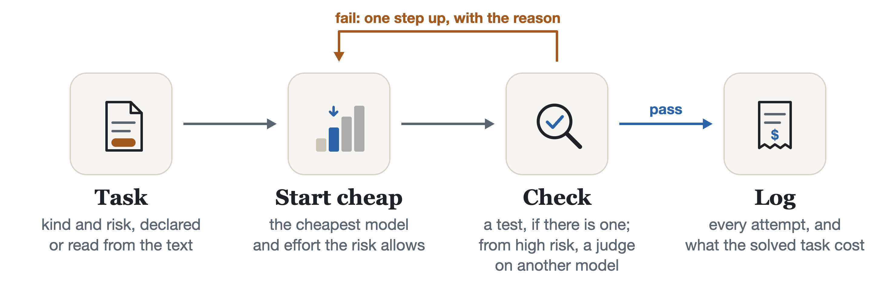

# model-router

[](https://github.com/dcamunas/model-router/actions/workflows/ci.yml)
[](https://github.com/dcamunas/model-router/releases)
[](pyproject.toml)
[](LICENSE)

**Picks the model and effort for every Claude Code subagent by its risk, and checks and escalates the work that needs it.**

<picture>
  <source media="(prefers-color-scheme: dark)" srcset="docs/showcase/flow-dark.png">
  
</picture>

In Claude Code the plugin does the first two steps for every subagent. The check and the climb run
through `router run` and, inside Claude Code, the `router` skill.

A subagent's bill is mostly its context, read again on every turn. One review subagent measured in
this repository ran on Opus for 36 turns and read 3.6M cached tokens: 1.43 USD of context alone, at
list price. model-router gives each subagent the model and effort its risk calls for, and learns per
repository which starts fall short.

Claude models only. Status: experimental. The start table is an assumption
([what is assumed](docs/how-it-decides.md#what-is-assumed)); each repository corrects it with its own
relaunches.

## Quick start

Needs Claude Code and [uv](https://docs.astral.sh/uv/).

```bash
claude plugin marketplace add dcamunas/claude-plugins
claude plugin install model-router@dcamunas
```

From the next session on, every general-purpose subagent launched without a model is routed, and
Claude Code shows one line per launch, such as `router: opus/medium (review/high)`. The plugin asks
Claude to declare the task on the first line of each subagent's prompt:

```text
kind: review, risk: high, access: read
```

The kind is one of `classify`, `extract`, `summarize`, `search`, `chat`, `write`, `code`, `review`,
`analysis` or `agentic`; the risk is `low`, `medium`, `high` or `critical`
([what each means](docs/how-it-decides.md#by-risk-at-a-glance)).

The plugin brings the `router` command (stats, plans, limits, text-only tasks) to Claude Code's shell, and
each Claude profile keeps its own state. Teams, upgrades and the command in a terminal:
[Install](docs/install.md).

## What you get

- **[The right model and effort per subagent](docs/claude-code.md#model-and-effort)**, from its kind and risk.
- **[Cheaper reading subagents](docs/claude-code.md#the-read-only-agent)**: 70 % less context cost in one measured review.
- **[What each subagent really cost](docs/claude-code.md#measurement)**: turns, tokens and peak context.
- **[Starts that learn per repository](docs/claude-code.md#learning-per-repository)**: up on their own, down by hand.
- **[One setup for a team repository](docs/install.md#in-a-team-repository)**: the plugin and risk floors for all.
- **[Team pooling, if you want it](docs/claude-code.md#shared-with-your-team-optional)**: weekly counts, no prompts.
- **[Cheap text-only tasks](docs/cli.md)**: `router run` carries about 900 tokens of context, not Claude Code's 100K.
- **[A cost for every solved task](docs/how-it-decides.md#6-ledger)** that `router run` and `router judge` handle.

## See it run


A real `router run` on a critical writing task: one attempt on `opus/medium`, one judge on another
model, solved.

## How it decides


An illustration: each frame is one rule, and each ticket's plan is what `router plan` gives with the
default tables.

1. **Kind and risk.** Declared on the first line, or read from the text. `critical` is never guessed.
2. **Start cell.** A table by kind and risk names a model at an effort: `haiku/medium` for a low-risk
   extraction, `opus/medium` for a high-risk review. Floors keep high-risk work on `sonnet/low` or
   above and critical work on `opus/medium` or above.
3. **Check.** A programmatic checker first, when the task has one. From high risk up, a judge on
   another model reads the answer in a fresh context.
4. **Climb.** A fail goes to the next cell up the ladder, with the reason. Every attempt and its cost
   go to the ledger.

The full rules, the ladder and who judges: [How it decides](docs/how-it-decides.md).

## Documentation

| I want to… | Read |
|---|---|
| Install, upgrade or remove it | [Install](docs/install.md) |
| Set it up for a whole team in one repository | [In a team repository](docs/install.md#in-a-team-repository) |
| Know what the plugin does to my subagents | [Inside Claude Code](docs/claude-code.md) |
| Turn the hooks off, or keep subagents off the read-only agent | [Environment variables](docs/claude-code.md#environment-variables) |
| Know what happens when a model's usage limit is spent | [Usage limits](docs/claude-code.md#usage-limits) |
| Run tasks from the command line or from Python | [Command line and library](docs/cli.md) |
| Use it with my Claude account, without an API key | [Without an API key](docs/cli.md#without-an-api-key-with-your-claude-account) |
| Understand how the start cell, the ladder and the judges are chosen | [How it decides](docs/how-it-decides.md) |
| See what is assumed and what is measured | [What is assumed](docs/how-it-decides.md#what-is-assumed) |
| Know what leaves my machine | [What leaves your machine](docs/privacy.md) |
| See where the idea comes from and how it compares with learned routers | [Background](docs/background.md) |
| See what changed in each version | [CHANGELOG](CHANGELOG.md) |

## Limits

- **Claude models only.** For a router trained across providers, look at the ones compared in
  [Background](docs/background.md).
- **Opinions until you measure.** Out of the box, the only number to trust is the ledger's real cost
  per solved task. The capabilities behind the start table are assumptions.
- **Learning needs volume.** Six launches of one kind on one start cell in one repository before
  anything moves.
- **Subagent costs are floors.** A transcript gives a lower bound for output tokens; context tokens
  are exact.
- **Only some subagents are routed.** General-purpose ones launched without a model. Your own agents,
  workflow agents and forks are measured, not changed; `router agents` advises on your own.

## Development

```bash
git clone https://github.com/dcamunas/model-router && cd model-router && uv sync
uv run pytest -q && uv run ruff check src tests docs/showcase && uv run pyright
uv run docs/showcase/flow.py && uv run --with pillow docs/showcase/build.py   # rebuild the figures
```

GitHub Actions runs the same checks on every push and validates the plugin with the Claude Code CLI.
Everything in the repository is in English; more in [Work on the repository](docs/install.md#work-on-the-repository).

## Licence

MIT. See [LICENSE](LICENSE).
