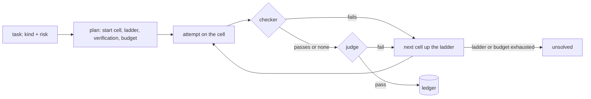

# How it decides

[← README](../README.md)

The rules behind each task: how kind and risk are read, where the task starts, how the answer is
checked, when it climbs and when it stops. This is the loop `router run` runs; in Claude Code the
plugin applies the first two steps to every subagent.

## By risk, at a glance

| Risk | Meaning | Verification | Lowest start | Budget per task |
|---|---|---|---|---|
| `low` | you read the result and can redo it | none | any cell | 0.10 USD |
| `medium` | the result is used without a second read | none | any cell | 0.50 USD |
| `high` | money, customers, production, legal, deletions, publishing | light: one judge on another model | `sonnet/low` | 2 USD |
| `critical` | as high, and hard to detect | full: one fixed judge | `opus/medium` | 10 USD |

A programmatic checker, when the task has one, always runs first and is final when it fails.

## Step by step

### 1. Kind and risk

**Declared or passed beats inferred, and `critical` is only ever declared.**

- The kinds: `classify`, `extract`, `summarize`, `search`, `chat`, `write`, `code`, `review`,
  `analysis`, `agentic`. The risks: `low`, `medium`, `high`, `critical`.
- You pass them (`--kind`, `--risk`), or the first two lines of the text declare them
  (`kind: review, risk: high`; also `tipo:` and `riesgo: alto`). A value ends the line or is followed
  by a comma or a full stop, and material pasted below the head never counts.
- Otherwise rules infer them; the rules know English and Spanish prompts.
- The risk is the damage a wrong answer does, and the text does not carry it. On 28 real tasks the
  rules got it right 9 times and a Haiku classifier 5 to 10, both reading difficulty or vocabulary
  instead of consequences. So a text that says "critical" or "production" is not a critical task for the
  router, and only a declaration makes it one.
- The high-risk keywords (money, customers, production, deletions, legal, health, credentials) still
  raise an undeclared risk to `high`.

### 2. Start cell

**A table by kind and risk; a repository's own evidence can move it; the floors cannot be lowered.**

- The `START` table in `policy.py` (kind × risk).
- In Claude Code, a repository where a start keeps failing starts it one step up
  ([learning per repository](claude-code.md#learning-per-repository)).
- The risk floors (`high` at `sonnet/low` or above, `critical` at `opus/medium` or above) hold over
  the table and any per-repository tuning. A repository can also raise the risk itself
  from what a brief says ([risk floors per repository](claude-code.md#risk-floors-per-repository)).
- A model over its usage limit is not available until the exact reset
  ([usage limits](claude-code.md#usage-limits)): its cells go to the next model, as for a model you lack.
- No cell the router picks on its own is at `max` effort: a `max` cell from a tuning runs at `xhigh`, and
  the plan says so.

### 3. Ladder

**Each step up is the cheapest cell that is clearly more capable.**

"Clearly" means +0.08 capability, among the available models. With the current assumptions:
`sonnet/medium`, then `opus/low`, `fable/low` and `fable/xhigh`.

### 4. Verification

**A checker first, then a judge by risk, on another model than the worker.**

- `low` and `medium` go unverified, `high` gets `light`, `critical` gets `full`. Full verification
  was the biggest cost sink; raise `high` to `full` with `--verify full` when a task needs it.
- `light` is the nearest other model at low effort (the tier above first), in a fresh context. A
  worker judging itself passed a quarter of the answers an independent judge failed.
- `full` is one fixed judge, `opus/xhigh` unless `router config --judge` says otherwise, on another model
  than the worker (see [Who judges](#who-judges)).

### 5. Stopping

**A pass, or one of the limits.**

A passing verdict, the ladder exhausted, the budget by risk (table above), two refusals in the same
task, the API down, or a judge that cannot be reached (the answer is kept and the status is `error`).
An answer cut by `max_tokens` is retried once on the same cell with twice the room.

### 6. Ledger

**Every attempt, with what it really cost.**

- `ledger.jsonl` in the router's folder of the Claude profile (`~/.claude/model-router` by default) keeps
  every attempt of `router run` and `router judge` with its real tokens and cost, the model that served it
  (when a fallback ran), the verdict, the reason and the router version. No prompt and no answer.

### 7. Escalation

**The next cell gets the reason the last one failed.**

After a verified fail, the next attempt's prompt carries the reason, so the next cell does not repeat
the mistake. `router stats` counts the retries that repeat it anyway.

## Who judges

**A fixed choice, not a climb up the lattice.**

- `full` uses one judge cell, `opus/xhigh` unless `router config --judge` says otherwise, in a fresh
  context.
- When the worker is already on that model, the judge moves to the next model up at low effort (Fable
  at low for an Opus worker), or to the model below when there is nothing above. The check stays a
  cross-check between models.
- No judge thinks above `xhigh`. `router config --judge opus/high` is the cheaper setting when
  verification is most of the bill: a judge at `high` writes about 60 % less thinking than one at
  `xhigh`. Verifying is easier than producing, so the judge does not have to outrank the worker; it
  has to be independent and good enough.

`light` is the nearest other model at low effort, the tier above before the one below, and never the worker's
own model when another is there. On a private eval of 28 real tasks, Haiku and Sonnet judging their own answers
in a fresh context passed 89 % and 93 % of first attempts. An Opus judge passed 64 % and 68 % of the same
answers, for word limits broken, formats ignored and facts invented. A model does not see its own
blind spots in a fresh context either.

Every judge's own verdict goes to the ledger, so `router stats` shows each judge cell's verdicts and pass
rate.

## What is assumed

Read these before you believe a number. The only measured ones are the ledger's real cost per solved
task and, in Claude Code, what each subagent spent.

- **Prices** in `catalog.py`, Anthropic API as of 2026-10-06. The ledger prices the real `usage`.
- **`EFFORT_OUTPUT_MULT`**: output tokens per effort relative to `high` (0.5 / 0.75 / 1 / 1.6 / 2.5).
- **`CAPABILITY_TIER` + `CAPABILITY_EFFORT`**: capability 0-1 per cell. Haiku 0.40, Sonnet 0.60, Opus 0.75,
  Fable 0.90; effort adds between −0.06 and +0.05. An opinion, not a measurement: it orders the ladder.
- **The `START` table** is a judgement per kind and risk. Per-repository learning corrects it where
  subagents keep failing.
- **Prompt caches are per model**: every model change in the ladder loses the cache. For a long
  conversation, change cells between conversations, not inside one.
