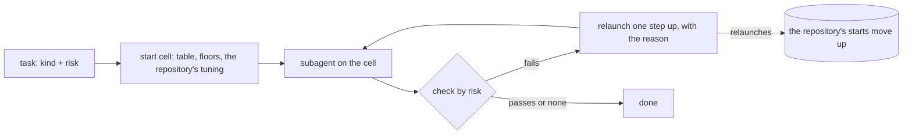

# How it decides

[← README](../README.md)

The rules behind each subagent: how kind and risk are read, where the task starts, what one step up is,
and who checks the work by risk. The hook applies the first two steps to every routed subagent; the
`router` skill asks Claude for the check and the relaunch.

## By risk, at a glance

| Risk | Meaning | Check | Lowest start |
|---|---|---|---|
| `low` | you read the result and can redo it | none | any cell |
| `medium` | the result is used without a second read | none | any cell |
| `high` | money, customers, production, legal, deletions, publishing | against the brief, or with a test | `sonnet/low` |
| `critical` | as high, and hard to detect | another subagent on another model | `opus/medium` |

A test, when there is one, always comes first and is final when it fails.

## Step by step

### 1. Kind and risk

**Declared or passed beats inferred, and `critical` is only ever declared.**

- The kinds: `classify`, `extract`, `summarize`, `search`, `chat`, `write`, `code`, `review`,
  `analysis`, `agentic`. The risks: `low`, `medium`, `high`, `critical`.
- You pass them (`router plan --kind --risk`), or the first two lines of the text declare them
  (`kind: review, risk: high`; also `tipo:` and `riesgo: alto`). A value ends the line or is followed
  by a comma or a full stop, and material pasted below the head never counts. A kind written by another
  of its names counts too: `research` is `search`, `writing` is `write`, `summary` is `summarize`,
  `extraction` is `extract`, `classification` is `classify` (`classify.KIND_ALIASES`).
- Otherwise rules infer them; the rules know English and Spanish prompts. A keyword that follows a
  negation in its clause ("do not run tests", "sin código", "never migrate") does not name the kind: the
  text says what the task is not, and the rule moves on to the next keyword.
- The risk is the damage a wrong answer does, and the text does not carry it. On 28 real tasks the
  rules got it right 9 times and a Haiku classifier 5 to 10, both reading difficulty or vocabulary
  instead of consequences. So a text that says "critical" or "production" is not a critical task for the
  router, and only a declaration makes it one.
- The high-risk keywords (money, customers, production, deletions, legal, health, credentials) still
  raise an undeclared risk to `high`.

### 2. Start cell

**A table by kind and risk; a repository's own evidence can move it; the floors cannot be lowered.**

- The `START` table in `policy.py` (kind × risk).
- In Claude Code, a repository where a start keeps failing starts it one step up
  ([learning per repository](claude-code.md#learning-per-repository)).
- The risk floors (`high` at `sonnet/low` or above, `critical` at `opus/medium` or above) hold over
  the table and any per-repository tuning. A repository can also raise the risk itself
  from what a brief says ([risk floors per repository](claude-code.md#risk-floors-per-repository)).
- A model over its usage limit is not available until the exact reset
  ([usage limits](claude-code.md#usage-limits)): its cells go to the next model, as for a model you lack.
- No cell the router picks on its own is at `max` effort: a `max` cell from a tuning runs at `xhigh`, and
  the plan says so.
- `router config --min-effort medium` (or `high`) raises every start below it to that effort on its own
  model, after the table, the floors and the tuning; the plan says so. The default is `low`, the
  table's own choices: on the bench of 21/10/2026 (112 tasks per cell) `sonnet/low` solved 92 % and
  `sonnet/medium` 90 %, `opus/low` and `opus/medium` 99 % each with medium 28 % dearer and slower, so
  the setting is for whoever wants the margin, not a measured need.

### 3. One step up

**Each step up is the cheapest cell that is clearly more capable.**

"Clearly" means +0.08 capability, among the available models. With the current assumptions:
`sonnet/medium`, then `opus/low`, `fable/low` and `fable/xhigh`. A repository's raise and the advice of
`router agents` both take this step.

### 4. The check

**A test first, then a check by risk, on another model than the worker.**

- `low` and `medium` go unchecked. For `high`, Claude checks the result against the brief, or with a
  test. For `critical`, another subagent on another model reads the brief and the result in a fresh
  context and answers `passed / reason / issues`.
- A worker judging itself passed a quarter of the answers an independent judge failed, so the check
  never runs on the worker's own subagent.
- On a fail, Claude relaunches the task one step up with the reason in the brief, and keeps the
  declaration line the same. The hook counts that relaunch as a fail of its first choice.

## Who judges a critical review

**A fixed choice, not a climb up the lattice.**

A critical review never runs on the model serving the chat: it is the only check the chat's own work gets,
since no hook can change the chat's model. When the start cell is on the chat's model, the hook moves the
review to the judge cell:

- `opus/xhigh` unless `router config --judge` says otherwise.
- When the start cell is already on that model, the judge moves to the next model up at low effort (Fable
  at low for an Opus review), or to the model below when there is nothing above. The check stays a
  cross-check between models.
- No judge thinks above `xhigh`. Verifying is easier than producing, so the judge does not have to
  outrank the worker; it has to be independent and good enough.

On a private eval of 28 real tasks, Haiku and Sonnet judging their own answers in a fresh context passed 89 %
and 93 % of first attempts. An Opus judge passed 64 % and 68 % of the same answers, for word limits broken,
formats ignored and facts invented. A model does not see its own blind spots in a fresh context either.

## What is assumed

Read these before you believe a number. The only measured ones are, in Claude Code, what each subagent
spent and how often a start was relaunched.

- **Prices** in `catalog.py`, Anthropic API as of 2026-10-06. Measurements price the real `usage`.
- **`EFFORT_OUTPUT_MULT`**: output tokens per effort relative to `high` (0.5 / 0.75 / 1 / 1.6 / 2.5).
- **`CAPABILITY_TIER` + `CAPABILITY_EFFORT`**: capability 0-1 per cell. Haiku 0.40, Sonnet 0.60, Opus 0.75,
  Fable 0.90; effort adds between −0.06 and +0.05. An opinion, not a measurement: it orders the steps up.
- **The `START` table** is a judgement per kind and risk. Per-repository learning corrects it where
  subagents keep failing.
- **Prompt caches are per model**: every model change loses the cache. For a long conversation, change
  cells between conversations, not inside one.
