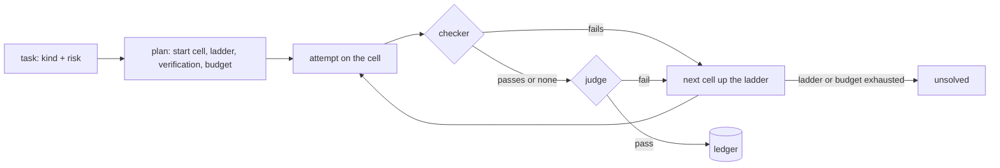

# How it decides

[← README](../README.md)

The rules behind each task: how kind and risk are read, where the task starts, how the answer is
checked, when it climbs and when it stops. This is the loop `router run` runs; in Claude Code the
plugin applies the first two steps to every subagent.

## By risk, at a glance

| Risk | Meaning | Verification | Lowest start | Budget per task |
|---|---|---|---|---|
| `low` | you read the result and can redo it | none | any cell | 0.10 USD |
| `medium` | the result is used without a second read | none | any cell | 0.50 USD |
| `high` | money, customers, production, legal, deletions, publishing | light: one judge on another model | `sonnet/low` | 2 USD |
| `critical` | as high, and hard to detect | full: one fixed judge | `opus/medium` | 10 USD |

A programmatic checker, when the task has one, always runs first and is final when it fails.

## Step by step

### 1. Kind and risk

**Declared or passed beats inferred, and `critical` is only ever declared.**

- The kinds: `classify`, `extract`, `summarize`, `search`, `chat`, `write`, `code`, `review`,
  `analysis`, `agentic`. The risks: `low`, `medium`, `high`, `critical`.
- You pass them (`--kind`, `--risk`), or the first two lines of the text declare them
  (`kind: review, risk: high`; also `tipo:` and `riesgo: alto`). A value ends the line or is followed
  by a comma or a full stop, and material pasted below the head never counts.
- Otherwise rules infer them; the rules know English and Spanish prompts. `--classify-llm` uses Haiku.
- The risk is the damage a wrong answer does, and the text does not carry it. On 28 real tasks the
  rules got it right 9 times and Haiku 5 to 10, both reading difficulty or vocabulary instead of
  consequences. So a text that says "critical" or "production" is not a critical task for the router.
- The high-risk keywords (money, customers, production, deletions, legal, health, credentials) still
  raise an undeclared risk to `high`.

### 2. Start cell

**A table by kind and risk; real verdicts can move it up; the floors cannot be lowered.**

- The `START` table in `policy.py` (kind × risk), or the table of the active calibration
  (`router calibrate --apply`; `router plan` names it, see [Calibration](calibration.md)).
- With 10 or more verified verdicts (a checker or a judge) for that kind, the feedback store moves the
  start up when its first-attempt pass rate falls below the break-even `c1 / c2`: the cost of an
  attempt on that cell, verification included, over the cost of the next step. Below that, starting
  cheap costs more.
- The risk floors (`high` at `sonnet/low` or above, `critical` at `opus/medium` or above) hold over
  the table, the feedback and any per-repository tuning.

### 3. Ladder

**Each step up is the cheapest cell that is clearly more capable.**

"Clearly" means +0.08 capability, among the available models. With the current assumptions:
`sonnet/medium`, then `opus/low`, `fable/low` and `fable/xhigh`.

### 4. Verification

**A checker first, then a judge by risk, on another model than the worker.**

- `low` and `medium` go unverified, `high` gets `light`, `critical` gets `full`. Full verification
  was the biggest cost sink; raise `high` to `full` with `--verify full`, or in `policy.py` once your
  bench justifies it.
- `light` is the nearest other model at low effort (the tier above first), in a fresh context. A
  worker judging itself passed a quarter of the answers an independent judge failed.
- `full` is one fixed judge, `opus/xhigh` unless `router config --judge` or `MODEL_ROUTER_JUDGE` say
  otherwise, on another model than the worker (see [Who judges](#who-judges)).

### 5. Stopping

**A pass, or one of the limits.**

A passing verdict, the ladder exhausted, the budget by risk (table above), two refusals in the same
task, the API down, or a judge that cannot be reached (the answer is kept and the status is `error`).
An answer cut by `max_tokens` is retried once on the same cell with twice the room.

### 6. Ledger

**Every attempt, with what it really cost.**

- `~/.model-router/ledger.jsonl` (`MODEL_ROUTER_HOME` moves it) keeps every attempt with its real
  tokens and cost, the model that served it (when a fallback ran), the verdict and the reason.
- It also keeps the router version, the calibration that decided, the task's fingerprint (a hash of
  kind, risk and prompt, so the same task can be compared across strategies and versions) and, for
  bench runs, the eval file and the repetition.
- `router.db` next to it is a SQLite index of the same records (tasks, attempts, every judge's
  verdict, overrides) for queries across months. The JSON-lines file stays the source, and
  `router db rebuild` reloads the index from it.

### 7. Escalation

**The next cell gets the reason the last one failed.**

After a verified fail, the next attempt's prompt carries the reason, so the next cell does not repeat
the mistake. `router stats` counts the retries that repeat it anyway.

## Who judges

**A fixed choice, not a climb up the lattice.**

- `full` uses one judge cell, `opus/xhigh` unless `router config --judge` or `MODEL_ROUTER_JUDGE` say
  otherwise, in a fresh context.
- When the worker is already on that model, the judge moves to the next model up at low effort (Fable
  at low for an Opus worker), or to the model below when there is nothing above. The check stays a
  cross-check between models.
- No judge thinks above `xhigh`. `router config --judge opus/high` is the cheaper setting when
  verification is most of the bill: a judge at `high` writes about 60 % less thinking than one at
  `xhigh`. Verifying is easier than producing, so the judge does not have to outrank the worker; it
  has to be independent and good enough.

`light` is the nearest other model at low effort, the tier above before the one below. Until 0.11.0
it was the worker's own cell in a fresh context. On a private eval of 28 real tasks, Haiku and Sonnet
passed themselves on 89 % and 93 % of first attempts. An Opus judge passed 64 % and 68 % of the same
answers, for word limits broken, formats ignored and facts invented. A model does not see its own
blind spots in a fresh context either.

Every judge's own verdict goes to the ledger, so `router stats` keeps a scoreboard per judge cell:
verdicts, pass rate, and how many of its verdicts you contradicted with `router feedback`. Those are
the numbers to pick a judge with, instead of the error rates the simulation assumes.
