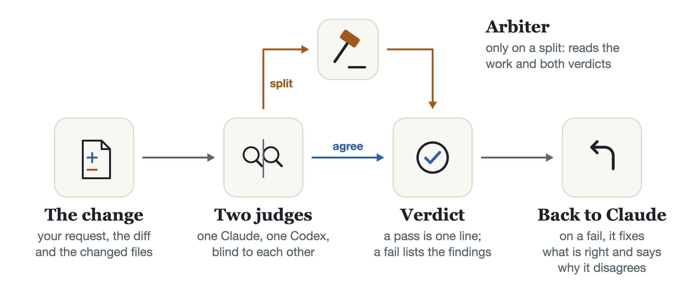

# tribunal

[](https://github.com/dcamunas/model-router/actions/workflows/ci.yml)
[](https://github.com/dcamunas/model-router/releases)
[](../../pyproject.toml)
[](../../LICENSE)

**A Claude judge and a Codex judge review each change blind to each other; an arbiter decides when they split.**

<picture>
  <source media="(prefers-color-scheme: dark)" srcset="../../docs/showcase/tribunal-dark.png">
  
</picture>

In Claude Code it reviews the code each turn changes, before the turn ends. From the command line it
reviews a branch, or a text written elsewhere.

A model reviewing its own work misses what it got wrong the first time. The tribunal asks another
company, never the model that wrote the change, and a third opinion only when the first two disagree.
It is a separate plugin in the [model-router](../../README.md) repository and shares its engine: the
verifier, the ledger and the doors to other providers. Status: experimental.

## Quick start

Needs Claude Code, [uv](https://docs.astral.sh/uv/) and, for judge B, a Codex home signed in with your
ChatGPT account.

```bash
claude plugin marketplace add dcamunas/model-router
claude plugin install model-router@dcamunas    # the tribunal runs from its environment
claude plugin install tribunal@dcamunas
uv tool install git+https://github.com/dcamunas/model-router@v0.15.1
tribunal config --codex-home ~/.codex          # your Codex home; lists its models
tribunal config --codex-models terra           # the Codex model that judges
```

From then on, a turn that changes code ends with one line, or with the findings sent back to Claude.
With an Opus chat and Terra as the Codex model, the line reads
`tribunal: pass (fable/medium + terra/high, arbiter sonnet/high), 3 files`. Without a Codex model it
still runs, with a second Claude model as judge B, and says so.

## What you get

- **[QA of every turn](docs/claude-code.md)** that changes code, against your request, before the turn ends.
- **[Two companies, blind](docs/judges.md)**: judge A is Claude, judge B is Codex; neither sees the other.
- **[An arbiter only on a split](docs/judges.md)**: one extra call, only when the judges disagree.
- **[A fail goes back to Claude](docs/claude-code.md)** with the findings, until the last review.
- **[Reviews from the command line](docs/cli.md)** of a branch, or of a text written elsewhere.
- **[A Codex judge that reads nothing else](docs/privacy.md)**: no shell, no web, no files beyond the prompt.

## See it on trial


An illustration built on a real review of `average()` dividing by zero. In that run both judges failed
it; the split is made up to show the arbiter.

## How it decides

1. **The change.** What the working tree became since your request: the diff and the changed files,
   with the request itself. A turn that changed only documentation is not judged.
2. **Two judges.** Judge A is a Claude model that did not write the change (Fable when the chat is
   Opus); judge B is the declared Codex model, at high effort. Each works in its own session.
3. **Verdict.** If they agree, that is the verdict. If they split, the arbiter decides: a Claude model
   neither judge is on, and not the chat's, reading both verdicts without names.
4. **Back to Claude.** A pass is one line. A fail returns the findings; Claude fixes what is right
   and says why it disagrees. Two reviews per turn by default; a fail in the last is reported to you.

The full rules and the settings: [Judges and arbiter](docs/judges.md) and
[QA of each turn](docs/claude-code.md).

## Documentation

| I want to… | Read |
|---|---|
| Know what happens at the end of a turn, and what is not judged | [QA of each turn](docs/claude-code.md) |
| Turn it off for a machine, a repository or one request | [Settings](docs/claude-code.md#settings) |
| Review a branch or a text from a terminal | [Command line](docs/cli.md) |
| Know which model sits where, and why not a council | [Judges and arbiter](docs/judges.md) |
| Know what Codex can read and what leaves my machine | [What reaches Codex](docs/privacy.md) |
| Install the router it runs on, or see what changed | [model-router](../../README.md), [CHANGELOG](../../CHANGELOG.md) |

## Limits

- **No parallel mode yet.** `qa: parallel`, Claude and Codex both building the same change and then
  comparing, is not built; it runs as a final review. It is the mode meant for migrations.
- **Submodules.** An edit inside a git submodule is not seen; the submodule counts as its committed
  pointer.
- **Large files.** Untracked files above 1 MB are left out of the snapshot (databases, logs, builds).
  Every snapshot writes the other files into `.git` as loose objects, which `git gc` removes in time.
- **Long diffs.** A diff longer than 30,000 characters reaches the judges as the list of every changed
  file and the first part of the diff; the changed files are shown whole up to 25,000 characters in
  all.
- **Prompt injection.** What the repository says is treated as material to review, never as
  instructions, but a judge is still a model reading text.

## Licence

MIT. See [LICENSE](../../LICENSE).
