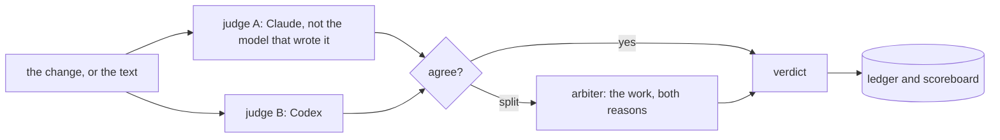

# tribunal

Two judges read the same work, each in its own session and blind to the other: a Claude model and a
Codex model. If they agree, that is the verdict. If they disagree, an arbiter reads both verdicts and
decides. In Claude Code it reviews the code each turn changes before the turn ends. From the command
line it reviews a code change, or a text written elsewhere.

It lives in the [model-router](../../README.md) repository and shares its engine (the verifier, the
ledger, the doors to other providers), but it is a separate plugin with its own settings. The router
picks a model and checks with one judge; the tribunal is the second opinion from another company,
and the third one only when the first two disagree.




## Install

```bash
claude plugin marketplace add dcamunas/model-router
claude plugin install model-router@dcamunas      # the tribunal runs from its environment
claude plugin install tribunal@dcamunas
uv tool install git+https://github.com/dcamunas/model-router@v0.15.0   # the `router` and `tribunal` commands
tribunal config --codex-home ~/.codex-personal   # a Codex home signed in with your ChatGPT account; lists its models
tribunal config --codex-models terra             # declare the Codex model that judges
```

Without a Codex model the tribunal still runs, with a second Claude model as judge B, and says so.

## In Claude Code: QA of each turn

When a turn changes code in a git repository, the plugin's `Stop` hook judges that change against
your request before the turn ends. Both judges get the request, the diff and the changed files as
they are now. The Claude judge also reads inside the repository, read-only, so it can open callers
and tests; the Codex judge reads nothing else (see "What reaches Codex"). A pass is one line. A fail goes back to Claude with
the findings, and Claude fixes what is right and says why it disagrees with the rest. A turn gets two
reviews by default; a fail in the last one is reported to you and the turn ends.

What counts as the change is what the working tree became since your request. The hook snapshots
the tree when the request arrives, through a temporary git index, so your index and your files are
not touched, and a commit made during the turn is still part of it. Not judged: a turn that changed
nothing, or only documentation (`.md`, `.rst`). A judge that cannot be reached, a spent quota for
instance, is reported and never blocks.

The settings are taken when your request arrives, so nothing the work writes during the turn can
switch its own review off. If another Claude Code session edits the same repository during the turn
(its transcript shows an editing tool), its edits are in the diff too, so a fail is reported to you
and not sent back. A session that only reads does not count.

## From the command line

```bash
tribunal qa --brief "what the change was for"            # uncommitted work in this repository
tribunal qa --base main --brief-file brief.md            # everything since main
tribunal qa --dry-run                                    # who would judge, and which files
tribunal judge "write the incident notice" --kind write --risk critical --answer notice.md
```

`tribunal judge` is for a text written elsewhere: critical prose, an analysis, a review; `--cell`
names the model that wrote it, so it is not one of its judges. Both exit 0 on a pass (or when there
is nothing to judge), 1 on a fail and 2 when they could not judge. Every verdict goes to the ledger:
`router stats` shows the judges' scoreboard and a line with the tribunal's reviews and spend.

## Who sits where

- Judge A is a Claude model, `opus/high` by default, and never the model serving the chat: that one
  wrote the change. With an Opus chat, it moves to Fable.
- Judge B is the declared Codex model of the highest tier, at high effort.
- The arbiter is a Claude model neither judge is on, and not the chat's unless nothing else is left.
  It reads the work and both verdicts as judge A and judge B, without names, and decides for itself.
  One extra call, only on a split.
- Only models this installation has are picked (`router config --models`). Judge B and the arbiter
  are never on judge A's model; when no other model is left, one judge decides alone and says so.
- When one judge cannot be reached, the other's verdict is still shown to you; it is not a tribunal,
  so nothing is sent back.

```bash
tribunal config                                          # what is set, and who would judge
tribunal config --codex terra/high --arbiter sonnet/high --rounds 2   # rounds: reviews per turn
tribunal config --mode off                               # this machine; `default` goes back
```

A repository can set its own in `.claude/tribunal.json`, for instance `{"mode": "off"}`, and a
request can say `qa: off` or `qa: final` in its first two lines. The later one wins: machine,
repository, request.

## Why two judges and not a council

Karpathy's `llm-council` sends one question to several models, has each one rank the others' answers
and lets a chairman write the final one. With four members that is nine calls per question, and most
of the value comes from mixing providers. The tribunal keeps the parts that pay: a second, independent
opinion from another company, and a third one only when the first two disagree. No shared answers,
no ranking, no chairman.

## Limits

- `qa: parallel`, Claude and Codex both building the same change and then comparing, is not built
  yet; it runs as a final review. It is the mode meant for migrations.
- An edit inside a git submodule is not seen; the submodule counts as its committed pointer.
- Untracked files above 1 MB are left out of the snapshot (databases, logs, builds). Every snapshot
  writes the other files into `.git` as loose objects, which `git gc` removes in time.
- A diff longer than 30,000 characters reaches the judges as the list of every changed file and the
  first part of the diff, and the changed files are shown whole up to 25,000 characters in all.
- What the repository says is treated as material to review, never as instructions, but a judge is
  still a model reading text.

## What reaches Codex

Only what the prompt carries: your request, the diff, and the changed files as they are now. Codex
runs in an empty directory with its shell, image viewer, web search, browser, desktop, apps and code
tools turned off, so it cannot open any file or page. This is on purpose. With a shell, Codex's
read-only sandbox still reads any file your user can read: in a test here it read a decoy file
outside the repository. Its image viewer did the same with an image. What they read goes to OpenAI.
Without those tools the judge sees the material and nothing else, and it is told to say so when
something it needed was cut.

The Claude judge reads inside the repository with Read, Grep and Glob; reading outside it is denied,
also tested. It loads only your user settings, not the repository's, whose hooks would otherwise run.
